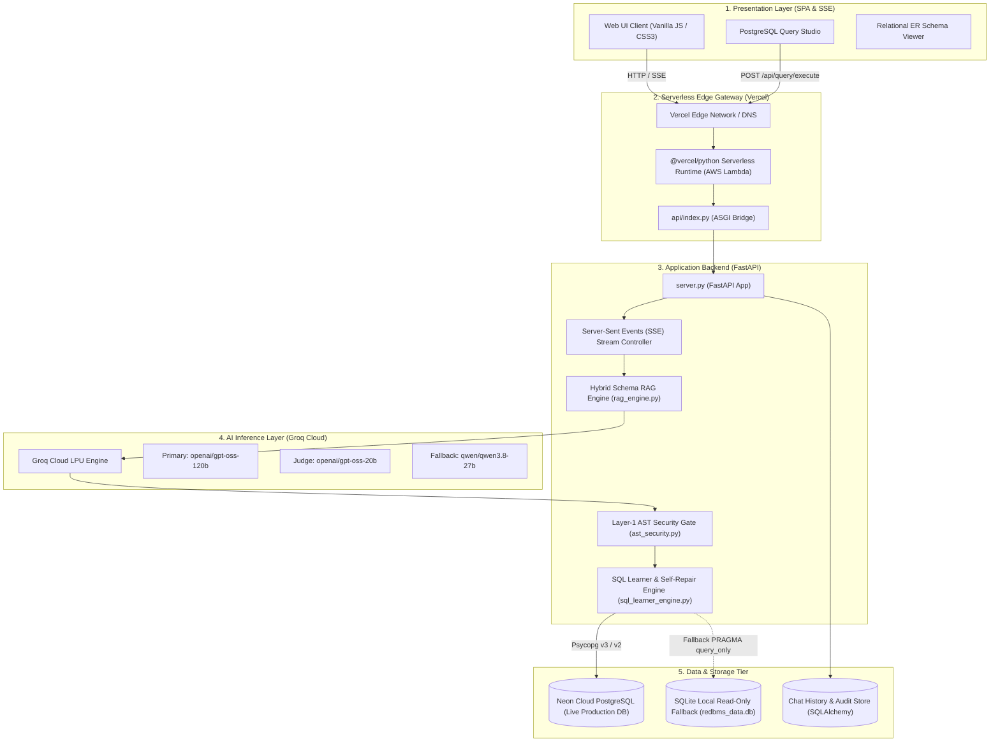
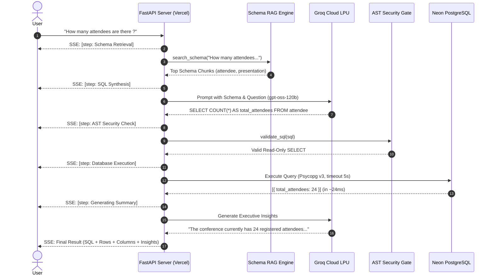

# QueryNova AI - Educational Text-to-SQL & SQL Learning Engine

QueryNova AI is an enterprise-grade, educational Text-to-SQL platform built with Python, FastAPI, and Neon Cloud PostgreSQL (with local SQLite fallback). It guides learners from natural language questions to validated, explained, and executed SQL queries across a relational Conference Management database.

---

## System Architecture

QueryNova AI is built on a serverless micro-framework designed for sub-second natural language query synthesis, rigorous AST-level security isolation, and dual-dialect execution against Neon Cloud PostgreSQL and local SQLite.

### Architecture Topology



---

### Request Execution Lifecycle



---

### Core Architectural Layers

1. **Presentation Layer (web_1/app.js & style.css)**:
   - Lightweight SPA built with vanilla JavaScript and modern CSS.
   - Real-time Server-Sent Events (SSE) reader for live pipeline status tokens.
   - Integrated PostgreSQL Query Studio with syntax editing, template queries, direct Neon DB execution, and CSV export.
   - Relational ER schema viewer displaying 1-to-N relationships and table keys.

2. **Serverless Edge Gateway (vercel.json & api/index.py)**:
   - Built on `@vercel/python` running inside AWS Lambda serverless execution environments.
   - Explicit `includeFiles` packaging ensures frontend templates, image assets, and RAG metadata chunks are bundled in the root.
   - In-memory pre-caching of `index.html` eliminates filesystem latency on cold starts.
   - Dedicated asset handlers (`/app.js`, `/style.css`, `/qnsql.webp`, `/schema_diagram.webp`) ensure strict MIME-type consistency across edge proxy rewrites.

3. **Security & Quality Gate (ast_security.py)**:
   - Layer-1 AST tokenizer (`sqlparse`) strictly restricts execution to single-statement `SELECT` queries.
   - Denylists all DDL and DML operations (`DROP`, `ALTER`, `TRUNCATE`, `INSERT`, `UPDATE`, `DELETE`, `GRANT`, `REVOKE`, `EXEC`).
   - Rejects queries containing destructive keywords or SQL injection comment markers (`--`, `/* */`).
   - Enforces a 5000ms statement execution timeout and automatic row capping (`LIMIT 1000`).

4. **AI Inference & Hybrid RAG (rag_engine.py & sql_learner_engine.py)**:
   - Hybrid lexical and semantic schema retrieval matching user queries against indexed schema definitions (`data/indices/chunk_metadata.json`).
   - Multi-model tiered orchestration via Groq Cloud LPU:
     - Primary Synthesizer: `openai/gpt-oss-120b` for dialect-aware SQL generation.
     - Judge / Evaluator: `openai/gpt-oss-20b` for AST validation and error reflection.
     - Fallback Model: `qwen/qwen3.8-27b` under circuit breaker protection.
   - Autonomous query self-repair with up to 2 reflection retries on database syntax exceptions.

5. **Dual-Backend Data Layer (database.py)**:
   - Primary: **Neon Cloud PostgreSQL** connected via dual-driver support (Psycopg 3 `psycopg[binary]` and Psycopg 2 `psycopg2-binary`).
   - Enforces physical transaction read-only isolation (`readonly=True, autocommit=True`).
   - Secondary: Local **SQLite** fallback (`NEW DB/redbms_data.db`) enforcing `PRAGMA query_only = ON;` for offline use and testing.
   - Persistent Chat & Audit Store: Managed through SQLAlchemy 2.0 ORM.

---

## Technology Stack

| Tier | Component | Technology / Library | Purpose |
|---|---|---|---|
| Frontend | UI & Studio | HTML5, CSS3 (Sunset Theme), Vanilla JS | Fast SPA without build-step overhead |
| Frontend | Code Studio | Monospace Custom Query Editor | SQL syntax editing, line numbering, and CSV export |
| Edge Gateway | Deployment | Vercel (@vercel/python) | Global serverless edge routing & Lambda compute |
| Backend API | Web Framework | FastAPI, Starlette, Uvicorn | High-throughput asynchronous REST & SSE endpoints |
| Database ORM | Data Modeling | SQLAlchemy 2.0 | Session management, chat history, and audit logs |
| Database Driver | PostgreSQL | psycopg[binary] v3 & psycopg2-binary | Dual-driver pooled connection to Neon Cloud |
| AI Inference | LLM Engine | Groq Cloud LPU | Sub-500ms SQL synthesis, reflection, and explanations |
| Security | AST Parser | sqlparse | Strict read-only statement token validation |
| Test Suite | Verification | pytest, pytest-asyncio | 67-test automated regression suite |

---

## Project Structure

```
├── api/                                # Vercel Serverless Function entry points
│   └── index.py                        # ASGI handler exposing FastAPI to Vercel
│
├── assets/                             # Project brand assets & diagrams
│   ├── logo.webp                       # QueryNova AI official logo
│   └── schema_diagram.webp             # 5-table conference relational schema diagram
│
├── data/                               # Schema metadata, indices, & local databases
│   ├── chunk_metadata.json             # Lexical & semantic schema chunks for RAG
│   ├── conference_management.db        # Fallback SQLite database
│   ├── knowledge_base.json             # Schema definitions and table relationships
│   ├── redbms_data.db                  # Local relational database file
│   └── schema_ddl.hash                 # SHA-256 hash verifying schema integrity
│
├── docs/                               # System documentation & technical audits
│   └── system_documentation.html       # Visual system architecture documentation
│
├── notebooks/                          # Research & prototyping notebooks
│   └── rag_pipeline_research.ipynb     # Interactive RAG experiment notebook
│
├── tests/                              # Automated test suite (67 tests)
│   ├── test_api_contracts.py           # REST & SSE endpoint contracts
│   ├── test_ast_security.py            # AST SQL security parser & read-only gates
│   ├── test_database_backends.py       # Neon PostgreSQL & SQLite backend switching
│   ├── test_postgresql_features.py     # PostgreSQL CTEs, joins, & window functions
│   ├── test_prompt4_enhancements.py    # Diagnostic explanations & breakdown logic
│   └── test_sql_learner_engine.py      # Typo diagnosis, repair loops, & classification
│
├── web_1/                              # Web frontend interface
│   ├── index.html                      # Main chat application & schema viewer
│   ├── app.js                          # Frontend client logic & SSE stream reader
│   ├── style.css                       # Sunset Orange / Flame Accent dark mode CSS
│   ├── qnsql.webp                      # Frontend logo asset
│   └── schema_diagram.webp             # Frontend schema diagram asset
│
├── ast_security.py                     # Layer 1 AST security validator (read-only policy)
├── auth_routes.py                      # Auth0 authentication integration routes
├── config.py                           # Central configuration & environment loader
├── database.py                         # TargetDatabaseManager & SQLAlchemy chat persistence
├── date_resolver.py                    # Temporal entity resolution (years, dates, quarters)
├── offline_pipeline.py                 # DDL drift hashing & memory ingestion pipeline
├── quality_gate.py                     # SQL semantic preservation & hallucination checks
├── rag_engine.py                       # Hybrid RAG schema retriever with circuit breaker
├── run.py                              # CLI application runner with custom port support
├── server.py                           # FastAPI application & real-time SSE query pipeline
├── sql_learner_engine.py               # 11-stage query classification, diagnosis & repair
│
├── .env.example                        # Template for required environment variables
├── .gitignore                          # Git ignore rules protecting credentials & cache
├── .vercelignore                       # Build exclusion list for lean Lambda bundles
├── requirements.txt                    # Lean production dependencies for Vercel & local
└── vercel.json                         # Vercel serverless routing configuration
```

---

## Quick Start (Local Development)

### 1. Prerequisites
- Python 3.10+
- Active virtual environment (`venv`)

### 2. Install Dependencies
```bash
pip install -r requirements.txt
```

### 3. Configure Environment Variables
Copy `.env.example` to `.env` and fill in your credentials:
```bash
cp .env.example .env
```

Key variables:
- `DATABASE_URL`: Neon Cloud PostgreSQL connection string (with `?sslmode=require`).
- `GROQ_API_KEY`: Groq API key for LLM inference (Llama 3.3 / GPT-OSS).

### 4. Start the Application
```bash
python run.py --port 8002
```
Access the application at [http://127.0.0.1:8002](http://127.0.0.1:8002).

---

## Running Automated Tests

Run the full automated test suite (67 tests across security, database backends, AST validation, and query repair):
```bash
python -m pytest tests/
```

---

## Deployment (Vercel + Neon Cloud)

QueryNova AI is configured for one-click serverless deployment on **Vercel** via `@vercel/python`, optimized with explicit asset bundling and memory pre-caching:

### Vercel Architecture Highlights
- **vercel.json Builds Configuration**: Uses `@vercel/python` with explicit `includeFiles` (`web_1/**`, `data/**`, `*.py`, `qnsql.webp`, `schema_diagram.webp`) guaranteeing all static assets and RAG schemas are bundled into the Lambda container.
- **Instant Root Response**: Pre-loads `index.html` into memory to eliminate cold-start filesystem latency and prevent "Cannot GET /" errors.
- **Dedicated Asset Routing**: Explicit endpoints for `/app.js`, `/style.css`, `/qnsql.webp`, and `/schema_diagram.webp` ensure correct MIME types across edge rewrites.
- **Lean Bundle Size**: Uses `.vercelignore` to exclude local tests, caches, and development databases, keeping deployment builds fast and minimal.

### Deployment Steps
1. **Push to GitHub**:
   ```bash
   git push origin main
   ```
2. **Import into Vercel**:
   - Log in to [vercel.com](https://vercel.com) and click **Add New Project**.
   - Import `https://github.com/Saravanakumarsk1210/-QueryNova_AI`.
   - Leave Framework Preset as **Other** (Vercel automatically detects `vercel.json`).
3. **Configure Environment Variables in Vercel Dashboard**:
   Add the following variables in **Settings > Environment Variables**:
   | Variable | Value / Description |
   |---|---|
   | `DATABASE_URL` | Your Neon Cloud PostgreSQL connection string (`postgresql://...`) |
   | `NEON_API_URL` | Your Neon API REST URL |
   | `GROQ_API_KEY` | Your Groq API key for LLM inference |
   | `TARGET_DB_TYPE` | `postgres` |
   | `DB_BACKEND_PREFERENCE` | `postgres` |
   | `PRIMARY_LLM_MODEL` | `openai/gpt-oss-120b` |
   | `JUDGE_LLM_MODEL` | `openai/gpt-oss-20b` |
   | `FALLBACK_LLM_MODEL` | `qwen/qwen3.8-27b` |
4. **Deploy**:
   - Click **Deploy**. Vercel will build and serve QueryNova AI instantly.
